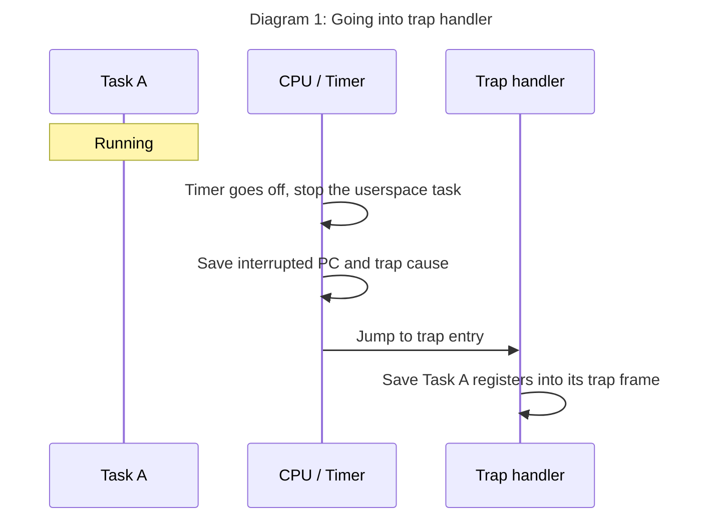
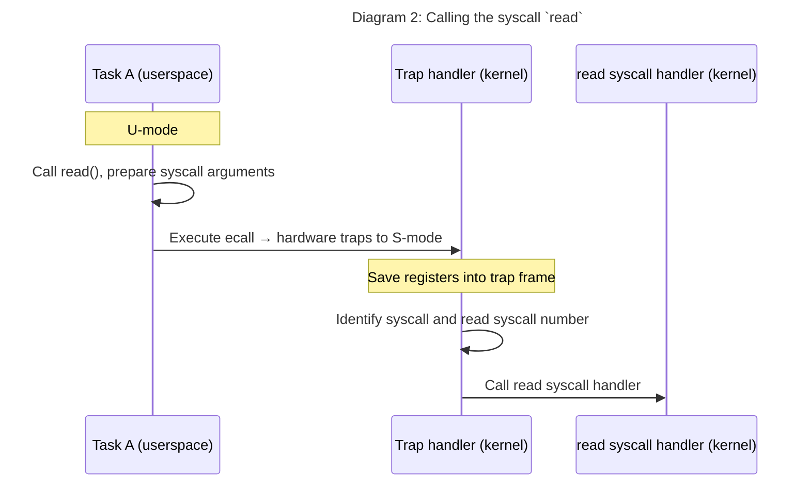

Right now when you read this post, you are actually living the illusion of your device is solely being used for showing
you this blog post. However, there are hundreds of tasks running in the background right now.
Your download is happening in the background, while you are reading this blog post, listening to a
music at the same time, even watching a video in the side because god forbid we focus on
a certain thing for some time.. Today, we are going to learn exactly how the
operating system gives us the illusion of all of them running at the same time. 

<details class="prompt-warning" markdown="1">
<summary>Why is this post haven't be written by LLMs</summary>

There's no need to talk about the usefullness of LLMs. However, I strongly believe that blog posts should
come from the people themselves instead of LLMs. The tone of the language used in the blog post, the humor,
the way of saying things, these all express the author. And I want the things I
read to have some character. Also, frankly, if the author didn't take their time to write the post, why
as a reader I spend my time reading it? I can already ask the LLM to explain certain thing to me right?

</details>

Let's first start understanding this with a basic setup where we have a single processing unit (core). This
means that at any instant, only a single instruction is running on the system. This realization comes with
the natural question:

<blockquote class="prompt-tip" markdown="1">

How's the operating system running when a user task runs on the core?

</blockquote>

The answer is simple, it's not. But this raises another question instantly:

<blockquote class="prompt-tip" markdown="1">

If the operating system is not running, what stops the user task to read or modify any memory, corrupt certain binaries?

</blockquote>

It's actually quite elegant. Because when we talk about operating systems, people tend to think it's a software that is
independent on which hardware it runs on. But the truth is, the operating system and the <TODO> works together to operate
the system. The hardware gives the operating system the right tools to ensure that the system runs correctly and safely and
the operating system utilizes hardware to achieve this goal. The first concept that we need to understand here are the priviledge
levels.

<details class="prompt-info" markdown="1">

<summary>RISC-V is chosen throughout this post to explain hardware-specific things.</summary>

I was always curious about how RISC-V works. Because it's very recent, I heard that it didn't come with the burden and backwards compatibility issue of
x86. So basically less things to worry about, and I was simply curious. So I started developing my OS by mainly targeting RISC-V.

</details>

Privilege levels are used to provide protection between different components of the software stack, and attempts to perform operations not
permitted by the current privilege mode will cause an exception to be raised[^priviledge-levels]. There are mainly 3 priviledge levels on
RISC-V (not counting hypervisor-related levels):


 | Level | Name             | Abbr  |
 |-------|------------------|-------|
 | `0`   | User/Application |  `U`  |
 | `1`   | Supervisor       |  `S`  |
 | `3`   | Machine          |  `M`  |

In the setup we care about in this post, assume the kernel is running in the `S-mode` and the user applications are running on the `U-mode`.
The beautiful thing with this is that, the kernel can choose to start tasks in the mode that it desires. And the userspace tasks are started
in the `U-mode`. This means whenever a userspace task is going to be executed, the machine goes into the `U-mode`. And the kernel is capable of
setting up the userspace task in a way that `U-mode` tasks cannot access to certain memory. This provides the protection we need because the
kernel simply decides on what the userspace task can access and with what permissions (RWX), and then these rules are enforced even when
the kernel is not on the core actively running. In order to understand memory protection and virtualizing the memory, we need to understand
the page tables and paging but it's going to be a future post. For now, we can just safely assume that thanks to these priviledge levels
the userspace task cannot comprimise the system unless it exploits a vulnerability in the kernel.


### Giving the control back to the OS

Alright, the userspace task is running on the machine by itself. But doesn't that simply mean if the untrusted user task doesn't give up
on the processing unit by itself, it can run forever?

Well, it can't and there are many reasons to it.

First of all, the user task will need to do some operations that require a higher priviledge level such as doing I/O operations. In the
end, what kind of a task it would be if it's not doing any I/O at all right? And in order to do that, the user task needs to yield the
execution to the operating system. It needs to tell the OS that it needs something that it can't do by itself. We generally know this
as the system calls. More on that later.

Secondly, you might now ask, "What if a malicious task never gives up the processing unit, never does a system call?" Exactly! And
again, like in many things, the operating system again needs a hand from the hardware here. The general purpose operating systems
we run today all use the same mechanism for this called `time-sharing`. By using a certain hardware future, the operating system
can set a timer that would go off and the hardware will interrupt whatever it is that running on the system, and goes into a predefined
address to continue execution. This is one of main things we are going to learn about today.

### Traps and trap handlers

Whenever the user task does a system call, or the hardware timer goes off, or say that you pressed a key on your keyboard, these all
raise the thing we call `interrupts`. The kernel sets a function called `trap handler` so that whenever an interrupt happens, the hardware
stops whatever executing right now, and continues the execution from the `trap handler`. On `RISC-V` we use the [stvec](https://docs.riscv.org/reference/isa/v20260120/priv/supervisor.html#11-1-1-2-supervisor-trap-vector-base-address-stvec-register)
register to set the `trap handler`.

<blockquote class="prompt-tip" markdown="1">

`stvec` is supervisor-level CSR[^csr], so it can't be used in the `U-mode`. This protects us from a user task injecting a malicious trap handler.

</blockquote>



`Diagram 1` shows us the scenario where the timer goes off and the hardware switches to executing our `trap handler`.

At the moment when the execution starts at the `trap handler`, the general purpose registers are exactly in the state when the hardware
interrupted `Task A`. This is very important because when the kernel executes, these general purpose registers are likely going to be
overwritten and we(the kernel) need to save these registers first so that we can go back to this exact state later.

We usually call the set of registers that we save on a trap entry the `trap frame`. The following code shows us [the definition
of the trap frame on efiks](https://github.com/aeryz/efiks-os/blob/22aab32aa670c55031092658a3899696436494dc/kernel/src/arch/riscv/trap/trap_frame.rs#L9).

```rust
pub struct TrapFrame {
    ra: usize,
    sp: usize,
    gp: usize,
    tp: usize,
    t0: usize,
    t1: usize,
    t2: usize,
    s0: usize,
    s1: usize,
    a0: usize,
    a1: usize,
    a2: usize,
    a3: usize,
    a4: usize,
    a5: usize,
    a6: usize,
    a7: usize,
    s2: usize,
    s3: usize,
    s4: usize,
    s5: usize,
    s6: usize,
    s7: usize,
    s8: usize,
    s9: usize,
    s10: usize,
    s11: usize,
    t3: usize,
    t4: usize,
    t5: usize,
    t6: usize,
    sepc: usize,
    scause: usize,
    sstatus: usize,
}
```
{: file="kernel/src/arch/riscv/trap/trap.S" }


One question might arise here:

<blockquote class="prompt-tip" markdown="1">

Where do we save the trap frame to if all the registers belong to the task that is interrupted?

</blockquote>

The almigthy hardware is again here to help. Previously, we learned that `stvec` is a `CSR` that can only be changed by the `S-mode` right?
As a matter of fact, there are a bunch of `CSR`s defined in RISC-V and one of them is called `sscratch`. Here, straight [from the `efiks` source](https://github.com/aeryz/efiks-os/blob/22aab32aa670c55031092658a3899696436494dc/kernel/src/arch/riscv/trap/trap.S#L9)

```text
trap_entry:

    # Swap user TLS with the current Task pointer. ThreadInfo is at offset 0. 
    csrrw tp, sscratch, tp
    ...
```

The trap immediately starts with the kernel swapping `tp` and `sscratch`. It's simply because `sscratch` is provided as a scratch register typically to be hold
a pointer to the kernel-defined user data. For `efiks`, this is the pointer to the task and this way, `efiks` can [swap the user stack with the kernel stack](https://github.com/aeryz/efiks-os/blob/22aab32aa670c55031092658a3899696436494dc/kernel/src/arch/riscv/trap/trap.S#L16).

```text
save_user_stack:
    # Save the sp to `user_sp` under `ThreadInfo` ..
    sd sp, 0*8(tp)
    # .. and load the `kernel_sp`.
    ld sp, 1*8(tp)
```

The kernel stack here is not a global stack that is shared by all the tasks. It's a per-task stack that is reserved for kernel's use only so that when kernel
gets the execution, it has a proper stack that is not altered by other tasks.

In the rest, we just save the trap frame and call the [`trap_handler`](https://github.com/aeryz/efiks-os/blob/22aab32aa670c55031092658a3899696436494dc/kernel/src/arch/riscv/trap/trap_handler.rs#L13).
The hardware thankfully provides the trap cause here in a `CSR` and some basic info about the trap. For example, if the user task were to touch a memory that it's not allowed to,
the trap would have the information on which memory access caused the trap, the instruction address that caused the trap, etc. This is also extremely valuable information
because this opens to door to us to do `copy-on-write`[^cow] and lazy allocation which we will cover in a future post (because it's also supported by `efiks` hurrayy).

```text
save_trapframe:
    # ..
    sd gp,  {TF_GP}(sp)
    # .. saving all the registers in the trap frame
    sd t6,  {TF_T6}(sp)

    # ..
    call trap_handler
```

So the `efiks` finally handles this trap in `Rust`:
```rust
fn trap_handler(trap_frame: &mut TrapFrame) {
    match trap_frame.get_cause() {
        TrapCause::ExternalIrq => (),
        TrapCause::TimerInterrupt => (),
        TrapCause::LoadPageFault => (),
        // ..
```

Right after handling the trap, we return to the userspace:
```
    call trap_handler

trap_resume:
    #..

    ld ra,  {TF_RA}(sp)
    # .. load back all the registers
    ld t6,  {TF_T6}(sp)

    #..

ret_userspace:
    csrw sscratch, tp
    # ..
    # Return the the userspace
    sret
```

Hold on hold on!!! We saved the registers and now we are loading them back in, so how do we actually switch to some other user task?

It's finally time for us to understand context switches.

### Context switches

You probably heard of the context switches some time in your education or your career somewhere. And truth be told, the context switch
by itself might be the easiest part among all of these.


```text
  csrw satp, a2
  sfence.vma zero, zero
  addi a0, a0, {context_offset}
  sd ra,   0*8(a0)
  sd sp,   1*8(a0)
  sd s0,   2*8(a0)
  sd s1,   3*8(a0)
  sd s2,   4*8(a0)
  sd s3,   5*8(a0)
  sd s4,   6*8(a0)
  sd s5,   7*8(a0)
  sd s6,   8*8(a0)
  sd s7,   9*8(a0)
  sd s8,  10*8(a0)
  sd s9,  11*8(a0)
  sd s10, 12*8(a0)
  sd s11, 13*8(a0)

  mv tp, a1
  addi a1, a1, {context_offset}
  ld ra,   0*8(a1)
  ld sp,   1*8(a1)
  ld s0,   2*8(a1)
  ld s1,   3*8(a1)
  ld s2,   4*8(a1)
  ld s3,   5*8(a1)
  ld s4,   6*8(a1)
  ld s5,   7*8(a1)
  ld s6,   8*8(a1)
  ld s7,   9*8(a1)
  ld s8,  10*8(a1)
  ld s9,  11*8(a1)
  ld s10, 12*8(a1)
  ld s11, 13*8(a1)

  ret
```

Considering `a0` and `a1` are the first and second arguments to [the swtch function](https://github.com/aeryz/efiks-os/blob/22aab32aa670c55031092658a3899696436494dc/kernel/src/arch/riscv/context.rs#L9), it's
as simple as storing one task's context and loading the other one's context. And as you can see from the `addi a0, a0, {context_offset}` part, we are simply getting
a pointer in the `Task` where the context is being saved. The `Task` pointer is the same pointer as we get in the trap entry (from `sscratch`).

Alright alright alright... But... We already saved the trap frame previously and now saving the same stuff again but as `Context` this time????

Let's take a look at it with a scenario:

Consider that you have two tasks: `Task A` and `Task B`. `Task A` called the `read` syscall and waiting for an input in the `stdin`. Let's trace this in a diagram:



It's the usual stuff. And let's take a peak into `efiks` to see [how this read is handled by the console](https://github.com/aeryz/efiks-os/blob/22aab32aa670c55031092658a3899696436494dc/kernel/src/console.rs#L28):
```rust
fn read(&self, _offset: usize, buf: &mut [u8]) -> vfs::VfsResult<usize> {
    let mut i = 0;
    while i < buf.len() {
        loop {
            match driver::uart::try_get_char() {
                Some(c) => {
                    buf[i] = if c == b'\r' { b'\n' } else { c };
                    i += 1;

                    if c == b'\n' || c == b'\r' {
                        return Ok(i);
                    }
                    break;
                }
                None => {
                    log::trace!("couldn't read anything, scheduling\n");
                    sched::block_on_external_irq(plic::UART0_IRQ);
                }
            }
        }
    }

    Ok(i)
}
```

When the `try_get_char` is called from the console, there may or may not been an input ready to be processed simply because noone might press any keys or send any
data yet right? So if the data is not available, we can't simply return back to the userspace because this is a blocking syscall expects the kernel to wait until
the data is there to be returned. So what do we do? We simply tell the scheduler that "Heyyo, I'm blocked. You are free to run any other task.".

From there, it's actually simple. `efiks` uses a round-robin scheduler, so it finds the next runnable task, and performs a context switch to it. Context switching
here switches necessary registers to the other task's snapshot (`Context`). This context switching simply gives us a very simple way to park the execution while
we are running at the kernel level and be able to return back to exactly where we left off when we get scheduled back. So next time `Task A` runs, it will
continue the execution from right after `sched::block_on_external_irq` and try reading the data one more time. And if it can read a character this time, it will
simply return to the trap handler and its userspace task's registers will get loaded back in by the trap handler.

### Time slicing and a final execution flow

I finally can mention the `time-sharing`. And we can finish this heavy post with a nice diagram.

We saw that tasks can yield the execution because they get blocked by the I/O operations. However as we said before, if they happen to be completely processing-bound
for an extended period, the kernel and the hardware collabrates to temporarily stop that task through the timer ticks. On `efiks`, this timer tick is set to be run
every `8ms` and all the tasks have a total of 4 time tick to work continuously on the core. This simply gives us `4 * 8 = 32ms`. If they don't yield, at the 4th timer tick,
kernel schedules out that task.

<blockquote class="prompt-tip" markdown="1">

For more, read the [OSTEP book's CPU scheduling section](https://pages.cs.wisc.edu/~remzi/OSTEP/cpu-sched.pdf). Tbf, read all of it. It's amazing.

</blockquote>


[^priviledge-levels]: [RISC-V priviledge levels](https://docs.riscv.org/reference/isa/v20260120/priv/priv-intro.html#privilege-levels).
[^csr]: [RISC-V control and status registers](https://docs.riscv.org/reference/isa/v20260120/priv/priv-csrs.html)
[^cow]: [Copy-on-Write](https://en.wikipedia.org/wiki/Copy-on-write) wikipedia reference
